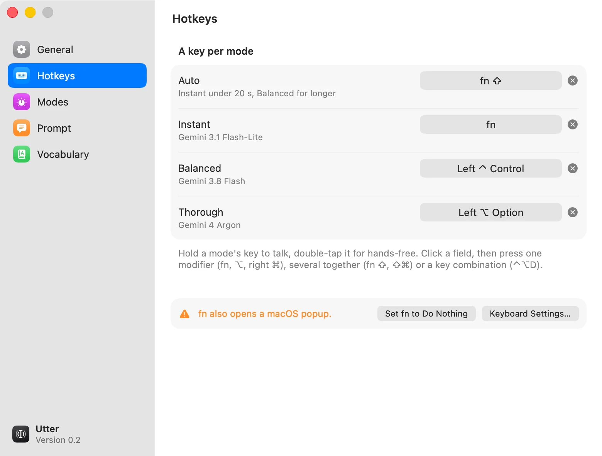

# Utter

Dictation for your Mac that works in any app. Hold a key, talk, let go, and the text is typed where your cursor is.

**[Download Utter for Mac](https://github.com/bitooz/utter/releases/latest/download/Utter.dmg)** · macOS 14 or later, Apple silicon or Intel

<picture>
  <source media="(prefers-color-scheme: dark)" srcset="website/public/img/hotkeys-dark.webp">
  
</picture>

Utter lives in the menu bar. Your speech becomes text through an audio model on [OpenRouter](https://openrouter.ai),
on your own OpenRouter key: there's no Utter account, no Utter server and no subscription, and you pay OpenRouter only
for what you dictate.

What's in it:

- **A key for each mode.** Auto, Instant, Balanced and Thorough, from fastest to most accurate, each started by its own
  key: a modifier on its own (fn, ⌥, right ⌘), a few modifiers together (fn ⇧) or a key combination (⌃⌥D). A new
  install starts with fn for Auto.
- **Hold to talk, or go hands-free.** Hold the key and talk, let go to paste. Double-tap it to keep talking without
  holding, then tap it once to finish. Esc cancels. A modifier key still works as usual in shortcuts.
- **Clean text.** What you meant to write, without fillers, stutters or the words you corrected yourself on. The prompt
  is yours to edit.
- **Vocabulary.** Names and terms spelled your way in every dictation ("Claude Code", not "Cloud Code").
- **Pastes where you were.** Into the text field that had the focus. With no text field focused, the text is copied to
  the clipboard instead, and your own clipboard is put back after a paste.
- **Quick, even for long dictations.** Short ones come back in about a second. Long ones are sent in blocks while you
  talk, cut only at real pauses, so they finish about as fast as a short one.
- **Your choice of model.** Each mode's model can be changed to any OpenRouter model that takes audio.

## Download

[Download Utter.dmg](https://github.com/bitooz/utter/releases/latest/download/Utter.dmg) from the
[latest release](https://github.com/bitooz/utter/releases/latest), open it and drag Utter onto Applications. It's one
app for Apple silicon and Intel, signed and notarized by Apple. It needs:

- **macOS 14 (Sonoma) or later.**
- **An OpenRouter key** with some credit on it. [Create one at openrouter.ai/keys](https://openrouter.ai/keys).

Utter doesn't update itself: new versions appear on the [Releases](https://github.com/bitooz/utter/releases) page.

## First launch

A setup window walks you through it: your OpenRouter key (checked with OpenRouter, with the credit left on it shown),
the Microphone and Accessibility permissions (Accessibility lets Utter notice its keys in any app and paste), a key for
each mode, and a field to try it in. *Set Up Utter…* in the menu runs it again, and everything in it can be changed
later in **Settings…** (⌘,).

## Privacy

- **Your key stays in your Keychain.** The OpenRouter key is saved in your login Keychain (service `OpenRouter`,
  account `dictation`) and nowhere else, not in a file and not in the app's settings.
- **Your audio goes only to your model on OpenRouter.** Utter records only while you hold a mode's key (or while
  hands-free is on) and sends the recording to OpenRouter, on your key, for the model of the mode you used. OpenRouter
  and that model's provider handle it under their own terms. Utter talks to no other server: no analytics, no crash
  reports, no update checks.
- **Little is kept on your Mac.** Each dictation adds a line of timings to `~/Library/Application Support/Utter/timings.csv`
  (lengths and times, no text), and the log in `~/Library/Logs/Utter` holds timings and errors, never what you said.
  The last recording is kept in memory for *Retry Last Dictation* and is gone when Utter quits. Audio is saved to disk
  only if you turn on *Keep Recordings for Benchmarks*.

## Build from source

You need macOS 14 or later and Xcode or the Xcode Command Line Tools (`xcode-select --install`), with Swift 5.10 or later.

```sh
git clone https://github.com/bitooz/utter.git
cd utter
scripts/build.sh      # builds build/Utter.app (and build/TestPad.app for the self-test)
open build/Utter.app
swift test            # the unit tests
```

`scripts/build.sh` signs the app with your Apple Development certificate if you have one, so macOS keeps the
Microphone and Accessibility permissions from one build to the next (`UTTER_SIGN_IDENTITY` picks another). Without one
it signs ad hoc, which runs fine but asks for the permissions again after each rebuild.

Releases are built by GitHub Actions: *Actions › Release › Run workflow* with a build number runs
`website/scripts/make-dmg.sh` (the app built for both architectures, signed with the Developer ID certificate,
notarized and stapled, in a disk image that is too) and publishes `Utter.dmg` as the latest release, tagged
`v<version>-<build>`, the version being the one in `VERSION`. `make-dmg.sh` also runs on a Mac with a Developer ID
certificate and an App Store Connect API key (see the top of the script).

[docs/how-it-works.md](docs/how-it-works.md) has the details: the hotkey rules, the modes and their models, how speech
is cut and sent, the measurements, the hidden settings, the end-to-end self-test and the layout of the code.

## License

Utter is released under the [MIT License](LICENSE).
